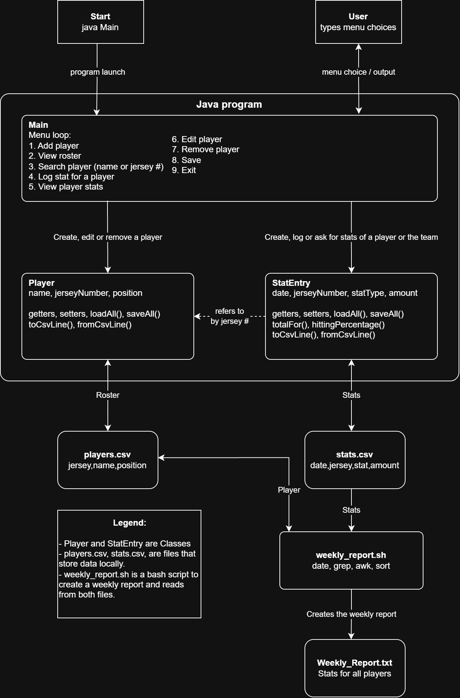

# volleyball-stat-tracker
CS 193 Final project. Volleyball team stat-tacker with java and bash with a CLI UI and a bash script to create a weekly schedule.

## Project Goal:
Creating a usable CLI Volleyball stat tracker interface which is menu driven, stores data, and (using bash) sends a weekly report to a local file.

## How it Works



- `Main` handles the menu, `InputHelper` validates everything the user types, and `Roster` holds the players and stat entries in memory.
- `DataStore` loads `data/players.csv` and `data/stats.csv` when ther user starts the program and saves them after every successful change.
- `scripts/weekly_report.sh` reads both CSV files and writes a table of each player's stats from the last 7 days, plus team totals, to `data/weekly_report.txt`.
- `scripts/crontab.example` holds a cron entry that runs the report automatically every Sunday at 8:00 PM.

## Tech Stack

- **Java 25** with `java.lang.IO` for console input and output, plus `ArrayList`, `java.io` and `java.time.LocalDate`
- **Bash** with `awk` and `date` for the weekly report
- **cron** for the weekly schedule
- **CSV files** for storage

## MVP Scope:
1. Add, remove, and edit a player’s stats
2. View roster
3. Log a stat for a player (with date)
4. View player stats, searching them by either player name or jersey number
5. Save/load to a CSV file
6. Input validation
7. Bash weekly report (last 7 days)

## Setup

You need Java 25 and a Linux or WSL terminal with Bash.

```
git clone https://github.com/NovaX3j/volleyball-stat-tracker.git
cd volleyball-stat-tracker/src
javac *.java
java Main
```

Run the program from inside `src/`. It saves its data to `../data/`.

To generate the weekly report after logging some stats (from the repository root):

```
cd ..
chmod +x scripts/weekly_report.sh
./scripts/weekly_report.sh
cat data/weekly_report.txt
```

## Future Plans:
1. Team totals
2. Leaderboard (top player per stat)
3. Multi-match / season view

## Video

Video: https://www.youtube.com/watch?v=rUH_j9Hxt1w